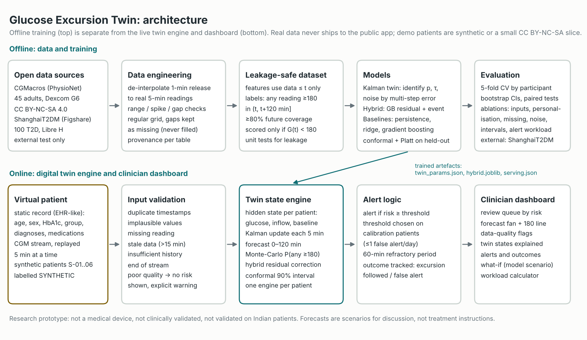

# Glucose Excursion Twin

A physiology-guided Digital Twin that forecasts a person's glucose over the next 2 hours and warns the care team
before a ≥180 mg/dL excursion. Each forecast states how uncertain it is, and the twin refuses to forecast when the
data are too poor.

> **Research prototype.** Not a medical device, not clinically validated, not validated on Indian patients.
> Never use it for diagnosis or treatment.

Submission for the **Happiest Health Digital Twin Challenge 2026** (Reimagining and Reforming Healthcare in India
Summit, Bengaluru).

**Quick links:** [Clickable prototype](https://mav-e-r-ick.github.io/MB25026_IITMandi/prototype/) ·
[Demo video](#demo-video) · [Presentation (PDF)](presentation/presentation.pdf) ·
[Architecture diagram (PDF)](docs/architecture.pdf) · [Evaluation report](reports/evaluation_report.md)

## Team details

| Field | Details |
|---|---|
| Team name | MB25026 |
| Team size | 1 (single-member team) |
| Team leader and member | Buddharatna Hingole |

## College / incubator information

| Field | Details |
|---|---|
| College / incubator | Indian Institute of Technology (IIT) Mandi |
| Programme | MBA, Data Science and AI specialisation |

## Project title

**Glucose Excursion Twin: a personalised, physiology-guided Digital Twin for 2-hour glucose-excursion forecasting
under uncertainty**

## Problem statement

India has an estimated 101 million adults with diabetes and 136 million with prediabetes (ICMR-INDIAB-17,
*Lancet Diabetes Endocrinol* 2023). Care is mostly reactive: HbA1c every few months, and finger-stick readings that
miss what happens between them. Continuous glucose monitors (CGMs) make the in-between visible, but no clinic team
can watch hundreds of continuous traces. The challenge asks for a Digital Twin that fuses static health records
with wearable data and predicts an adverse event before it happens.

## Healthcare use case

A diabetes educator or physician monitors a panel of patients who wear CGMs. For each patient the twin keeps a
virtual state that combines the static record (age, sex, HbA1c, diabetes status) with the live CGM stream. It
updates every 5 minutes, forecasts the next 2 hours with a 90% interval, and ranks patients by their risk of an
excursion so the team knows who needs attention now.

**Adverse event predicted:** any CGM reading ≥ 180 mg/dL within the next 120 minutes, predicted while glucose is
still below 180. 180 mg/dL is the upper limit of the international time-in-range target; here it is a configurable
research definition, not a treatment target.

## Technical stack

| Layer | Tools |
|---|---|
| Language | Python 3.12 |
| Data | pandas, NumPy |
| Physiological model and system identification | SciPy (optimisation), numba (optional speed-up) |
| Machine learning | scikit-learn: HistGradientBoosting, ridge, logistic regression |
| Uncertainty | split-conformal prediction (implemented in this repo) |
| Live dashboard | Streamlit, Plotly |
| Clickable prototype | single self-contained HTML/JavaScript page (`prototype/index.html`) |
| Testing | pytest (14 tests, including data-leakage tests) |
| Hardware | CPU only, no GPU needed |

## AI/ML model and framework details

```
static profile (EHR) ─┐
                      ├─► feature builder (past data only) ─► gradient-boosting residual + event model ─┐
CGM stream ─► checks ─┤                                                                                ├─► forecast, risk,
                      └─► Kalman state-space twin  (glucose, inflow, personal baseline) ─────────────────┘   90% interval,
                                │  updates every 5 min, handles gaps                                         alerts, dashboard
                                └─► optional personalisation (refit on the patient's own first 3 days)
```

- **Twin model (physiology):** `dG/dt = −p(G − B) + R`. Glucose `G` returns to a personal baseline `B`; an
  unobserved inflow `R` (meals, liver output, stress) decays over about 20 minutes. The model is linear, so a
  Kalman filter is the exact update, and missing readings simply widen its uncertainty. Parameters are identified
  by minimising 15–120-minute forecast error: `p ≈ 0.015/min`, `τ ≈ 20 min`.
- **Hybrid (machine learning):** scikit-learn HistGradientBoosting learns the twin's residual error at 15, 30, 60,
  90 and 120 minutes, plus a classifier for the 2-hour excursion risk (Platt-calibrated). Inputs: twin states and
  forecasts, recent glucose lags, trends and variability, time of day, and the static profile.
- **Uncertainty:** 90% split-conformal intervals calibrated on held-out *patients*, separately per diabetes group.
- **Event probability:** Monte-Carlo over whole forecast trajectories, because consecutive readings are correlated.
- **Baselines compared:** persistence, ridge autoregression, gradient boosting, the pure Kalman twin.
- **Evaluation:** 5-fold cross-validation by participant (45 people), separate calibration participants, and an
  external test on 100 more people (ShanghaiT2DM).

The physiology, maths and design choices are in [`docs/methodology.md`](docs/methodology.md).

## Demo video

**Unlisted YouTube link: to be added.** About 20 minutes: problem, data, model, evaluation, and a walkthrough of
the prototype.

## Prototype

1. **Clickable prototype, no install:** <https://mav-e-r-ick.github.io/MB25026_IITMandi/prototype/>. A virtual ward of
   10 patients (6 synthetic, 4 real de-identified CGMacros participants, each labelled) replayed 5 minutes at a time.
   Every forecast in it was produced in advance by the trained twin (`scripts/export_prototype_data.py`); the page
   only plays them back. The same file is at [`prototype/index.html`](prototype/index.html).
2. **Live dashboard:** the Streamlit app runs the twin itself, one update per click (see *Run it* below).

## Architecture diagram

[`docs/architecture.pdf`](docs/architecture.pdf) (PNG preview below).



## Presentation

[`presentation/presentation.pdf`](presentation/presentation.pdf): 16 slides covering the problem, data, model,
evaluation, prototype, clinical value, limits and next steps.

## Results (5-fold cross-validation by participant, 45 people; external test on 100 more)

| Model | MAE 60 min | MAE 120 min | AUROC | AUPRC |
|---|---|---|---|---|
| Persistence | 19.4 | 26.8 | 0.62 | 0.26 |
| Ridge AR | 17.4 | 21.5 | 0.79 | 0.45 |
| Gradient boosting | 17.3 | 21.5 | 0.80 | 0.45 |
| Kalman twin | 17.6 | 21.4 | 0.78 | 0.43 |
| **Hybrid twin** | **17.2** | **21.1** | **0.81** | **0.47** |

- **The hybrid is best on every event metric, but the gain over gradient boosting is not statistically
  significant.** The paired per-participant difference has a 95% CI spanning zero.
- **Missing data:** with 30% of readings removed, the twin's accuracy is unchanged; ridge regression degrades most.
- **Noisy sensor:** changing one twin parameter (sensor noise) cuts 15-min error from 15.1 to 10.7 mg/dL with no
  retraining.
- **Alerting:** at about 1 false alert per patient-day, the hybrid warns of 64% of excursions, a median of
  40 minutes ahead.
- **External test (ShanghaiT2DM):** plain gradient boosting transferred best (AUROC 0.80 vs hybrid 0.79).
- **The static profile (age, sex, HbA1c) added nothing** beyond the CGM history.

Full tables, confidence intervals and all ablations: [`reports/evaluation_report.md`](reports/evaluation_report.md).

## Data — anonymised, open and synthetic only

| Source | Role | Licence |
|---|---|---|
| CGMacros (PhysioNet, 45 adults, real, de-identified) | training, cross-validation, small demo slice | CC BY-NC-SA 4.0 |
| ShanghaiT2DM (Figshare, 100 adults, real, de-identified) | external test only, never redistributed | no licence attached |
| Synthetic patients `S-01`…`S-06` | public demo | generated by `src/gtwin/simulate.py` |

Raw data are not in this repository. `scripts/get_data.py` downloads them. What is real and what is synthetic is
listed in [`DATA_LICENSES.md`](DATA_LICENSES.md).

**Data-quality finding:** the CGMacros release linearly interpolates Dexcom readings onto a 1-minute grid. Using
those rows leaks future readings into features. We recover the 125,819 real 5-minute readings (see
`src/gtwin/data/cgm.py`, with tests).

## Run it (Windows PowerShell)

```powershell
git clone https://github.com/Mav-e-r-ick/MB25026_IITMandi.git
cd MB25026_IITMandi
py -3.12 -m venv .venv
.\.venv\Scripts\Activate.ps1
pip install -r requirements.txt

# dashboard only (uses the shipped model files and demo patients)
streamlit run app/streamlit_app.py

# full reproduction (about 30 minutes on a laptop)
python scripts/get_data.py
python -m pytest
python scripts/run_experiments.py
python scripts/summarize.py
python scripts/make_figures.py
python scripts/train_final.py
python scripts/export_prototype_data.py   # about 25 minutes
python scripts/build_prototype.py
```

## Repository layout

```
app/streamlit_app.py        clinician dashboard (runs the twin live)
prototype/index.html        self-contained clickable prototype (pre-computed replay)
src/gtwin/data/             loaders, de-interpolation, quality checks
src/gtwin/dataset.py        leakage-safe features and labels
src/gtwin/models/           Kalman twin, ML models, hybrid
src/gtwin/evaluation/       metrics, conformal intervals
src/gtwin/twin/engine.py    live twin state engine (replay, validation, alerts)
src/gtwin/simulate.py       synthetic patient generator
scripts/                    data download, experiments, summaries, figures, final training
models/                     trained artefacts used by the app (CC BY-NC-SA 4.0, see DATA_LICENSES.md)
reports/                    evaluation report, result tables, figures, dataset audit
docs/                       methodology, architecture diagram (PDF, PNG)
presentation/               presentation (PDF)
tests/                      pytest suite, including leakage tests
```

## Limitations

- 45 training participants (14 with T2D) from one US site, with semi-standardised meals.
- No meal, activity, insulin or medication inputs in this run. The twin cannot tell *why* glucose rises.
- Twin states (inflow, baseline) are modelling quantities, not measured physiology.
- Conformal coverage was 0.87–0.88 against a 0.90 target, and lower for T2D with marginal calibration.
- Not evaluated on Indian patients. The external test shows performance can shift between populations.
- Probabilities above 0.7 are somewhat over-confident.

## Open-source licence details

- **Code:** MIT licence, see [`LICENSE`](LICENSE).
- **Data and trained models:** keep their source licences. CGMacros data and models trained on it are
  CC BY-NC-SA 4.0 (non-commercial, attribution, share-alike); ShanghaiT2DM is used for testing only and is not
  redistributed. Details in [`DATA_LICENSES.md`](DATA_LICENSES.md).
CGMacros: Gutierrez-Osuna R, Kerr D, Mortazavi B, Das A, PhysioNet (2025), doi:10.13026/3z8q-x658;
Das A et al., *Sci Data* 12, 1557 (2025).

## Public access

All files in this repository and all links above are public and open without sign-in or extra permissions.
