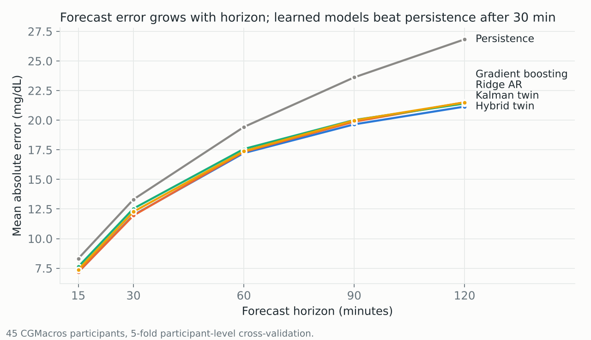
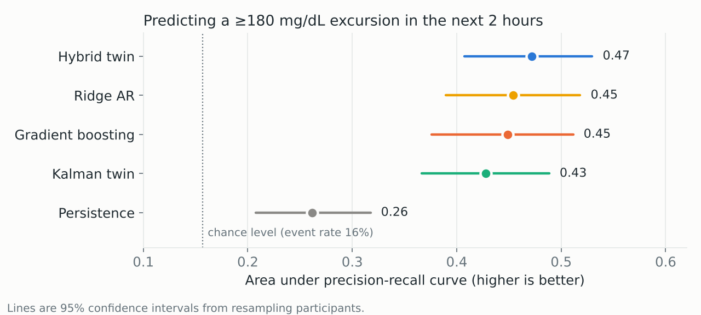
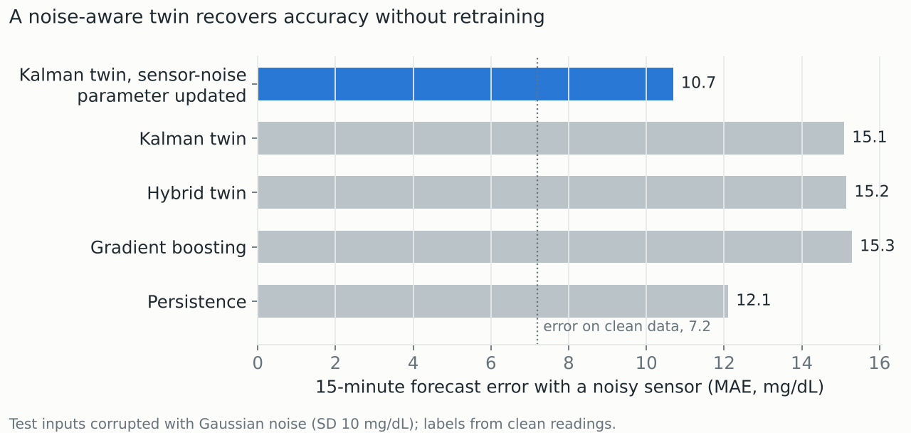
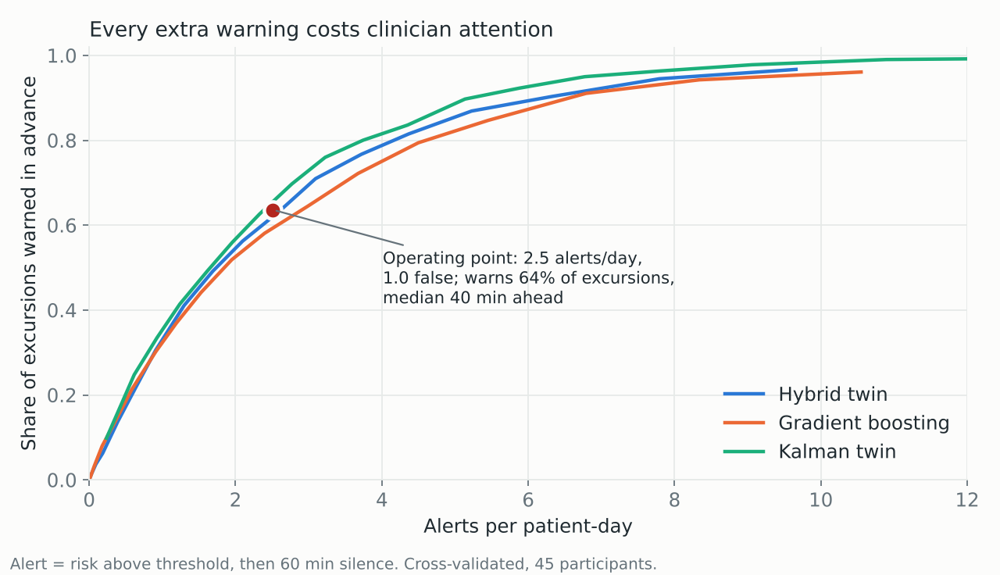

# Evaluation report

Run date: 14 October 2026 · Code: `scripts/run_experiments.py` → `scripts/summarize.py` → `scripts/make_figures.py`.
All numbers below are reproduced from `reports/results/summary_*.csv`.

## 1. Data actually used

| | CGMacros (train + cross-validation) | ShanghaiT2DM (external test) |
|---|---|---|
| Participants | 45 (15 healthy, 16 prediabetes, 14 T2D) | 100 T2D |
| Sensor | Dexcom G6, 5 min (real readings recovered from 1-min interpolated release) | FreeStyle Libre H, 15 min |
| Monitoring | 452 participant-days; ~10 days each | 3–14 days each (some participants have repeat recordings) |
| Missing readings | mean 2.7%, median <0.1%; two participants ~50% | 20.7% of 15-min slots |
| Static profile used | age, sex, HbA1c (diabetes group used only for stratification and reporting) | not used (glucose-only model) |
| Prediction points (every 15 min) | 41,083; 34,643 scorable for events; **5,427 excursion labels** | 88,639 scorable; 13,521 excursion labels |

Event rate among scorable points: healthy 7.5%, prediabetes 15.9%, T2D 27.6%.

**Not available in this run:** meal records, Fitbit heart rate/activity and the full laboratory panel. These are in
the PhysioNet release, which the build environment could not reach. The code paths exist (`load_cgmacros_events`,
meal-mode Kalman model, automatic extra static features) and are the first thing to add.

## 2. Main results (5-fold participant-level cross-validation, 45 participants)

| Model | MAE 30 | MAE 60 [95% CI] | MAE 120 [95% CI] | AUROC | AUPRC [95% CI] | Brier |
|---|---|---|---|---|---|---|
| Persistence | 13.3 | 19.4 [17.6–21.3] | 26.8 [24.0–29.8] | 0.62 | 0.26 [0.21–0.32] | 0.128 |
| Ridge AR | 12.3 | 17.4 [15.8–19.0] | 21.5 [19.2–23.8] | 0.79 | 0.45 [0.39–0.52] | 0.108 |
| Gradient boosting | 12.0 | 17.3 [15.8–18.8] | 21.5 [19.2–23.8] | 0.80 | 0.45 [0.38–0.51] | 0.109 |
| Kalman twin (mechanistic) | 12.5 | 17.6 [15.9–19.3] | 21.4 [19.0–24.0] | 0.78 | 0.43 [0.37–0.49] | 0.118 |
| **Hybrid twin** (Kalman + GB residual) | 12.0 | **17.2** [15.7–18.8] | **21.1** [18.6–23.5] | **0.81** | **0.47** [0.41–0.53] | **0.106** |

MAE in mg/dL. Chance AUPRC equals the event rate, 0.157.

### Did the hybrid beat the alternatives? Paired, per-participant comparison

| Hybrid minus … | Horizon | Mean ΔMAE (mg/dL) | 95% CI | Participants where hybrid was better |
|---|---|---|---|---|
| Gradient boosting | 30 min | +0.03 | −0.05 to +0.12 | 19 / 45 |
| Gradient boosting | 60 min | −0.12 | −0.37 to +0.14 | 27 / 45 |
| Gradient boosting | 120 min | −0.34 | −0.93 to +0.24 | 28 / 45 |
| Kalman twin | 30 min | **−0.53** | **−0.75 to −0.32** | 37 / 45 |
| Kalman twin | 60 min | −0.32 | −0.72 to +0.05 | 27 / 45 |

**Verdict on the research question:**
- The hybrid is the best model on every event metric and on 60–120-minute error.
- Its advantage over plain gradient boosting is small and **not statistically distinguishable** with 45 people.
- It is clearly better than the pure mechanistic twin at short horizons.
- Ridge regression is nearly as good as gradient boosting, so most of the signal is linear in recent glucose.

### By diabetes group (hybrid)

| Group | MAE 60 | MAE 120 | AUROC | AUPRC | Event rate |
|---|---|---|---|---|---|
| Healthy (15) | 13.4 | 16.0 | 0.80 | 0.28 | 7.5% |
| Prediabetes (16) | 16.7 | 19.5 | 0.77 | 0.42 | 15.9% |
| T2D (14) | 21.9 | 28.4 | 0.79 | 0.57 | 27.6% |

T2D glucose is harder to forecast in absolute terms: errors are 60–80% larger than in healthy participants
(MAE 21.9 vs 13.4 at 60 min; 28.4 vs 16.0 at 120 min).

### Probability calibration (hybrid)

Predicted risks match observed rates closely up to about 70%. Above that the model is over-confident: the
0.9–1.0 bin has 20 points and an observed rate of 75%. The dashboard therefore never shows risks as certainties.

## 3. Ablations

**A. Sensor vs profile vs fused inputs**

| Gradient boosting inputs | MAE 120 | AUPRC |
|---|---|---|
| Profile (age, sex, HbA1c) + current reading | 24.6 | 0.28 |
| Sensor features only | 21.0 | 0.47 |
| Fused (sensor + profile) | 21.5 | 0.45 |

The static profile **did not add** predictive value beyond the CGM history. HbA1c ranks third in the fused model's
permutation importance, but the 24-hour mean glucose carries the same information. Richer EHR fields (BMI, HOMA-IR,
lipids, medications) were unavailable and remain untested.

**B. Personalisation** (refit `p`, `τ` on the patient's first 3 days, evaluate on later days only)

| Model | MAE 30 | MAE 60 | MAE 120 | AUROC |
|---|---|---|---|---|
| Kalman twin, population | 12.27 | 17.20 | 20.81 | 0.772 |
| Kalman twin, personalised | **11.98** | **16.87** | **20.67** | **0.786** |
| Hybrid, population | 11.70 | 16.81 | 20.56 | 0.813 |
| Hybrid, personalised twin inside | 12.07 | 17.42 | 21.44 | 0.773 |

- Personalisation **helps the mechanistic twin modestly.** Fitted per-patient return rates range 0.009–0.033/min
  (median 0.017) and inflow decay 8–33 min, so people really do differ.
- Plugging the personalised twin into the hybrid **hurts**. Its residual model was trained on population-twin
  outputs, and changing the twin underneath shifts its inputs. Personalising the hybrid properly needs the residual
  model to be retrained on personalised twin outputs (future work).

**C. Missing data** (30% of readings deleted at random at test time; same prediction points)

| Model | MAE 60 clean → missing | AUPRC clean → missing |
|---|---|---|
| Kalman twin | 17.62 → 17.63 | 0.434 → 0.434 |
| Hybrid | 17.27 → 17.54 | 0.472 → 0.460 |
| Gradient boosting | 17.41 → 17.61 | 0.450 → 0.445 |
| Ridge AR | 17.44 → 18.76 | 0.461 → 0.420 |

The Kalman twin is unaffected because missing readings are part of its model. Ridge regression degrades the most.

**D. Sensor noise** (Gaussian noise, SD 10 mg/dL, added to inputs at test time)

Every model trained on clean data degrades badly at short horizons. **Changing one physical parameter**, the twin's
sensor-noise variance, cuts 15-minute error from 15.1 to 10.7 mg/dL and 30-minute error from 19.0 to 14.4 mg/dL,
with no retraining. A black-box model cannot be adjusted this way. This is the clearest practical benefit of the
explicit state-space structure in this study.

**E. Uncertainty** (90% split-conformal intervals, calibrated on held-out participants)

| Hybrid, coverage at 120 min | Marginal calibration | Group-conditional calibration |
|---|---|---|
| Healthy | 0.93 | 0.84 |
| Prediabetes | 0.90 | 0.88 |
| T2D | **0.78** | **0.85** |

Overall coverage is 0.87–0.88, below the nominal 0.90. Marginal intervals under-cover T2D. Group-conditional
calibration fixes most of that but over-corrects in healthy participants. Each fold calibrates on only 2–3
participants per group, and coverage guarantees assume participants are exchangeable, which a cohort of 45 strains.
**Intervals should be presented as approximate.**

**F. Alert workload**

| Policy (hybrid) | Alerts / patient-day | False alerts / day | Excursions warned | Median lead |
|---|---|---|---|---|
| Threshold chosen on calibration patients (≤1 false alert/day) | 2.5 | 1.0 | 64% | 40 min |
| Fixed risk ≥ 0.5 | 2.1 | 0.8 | 56% | 35 min |
| Fixed risk ≥ 0.7 | 0.6 | 0.2 | 22% | 22 min |

- Warning of most excursions costs roughly 2–3 alerts per patient per day.
- At equal alert volume, the pure Kalman twin's own probability warns of slightly more excursions than the hybrid
  (see figure). Better discrimination of individual points does not automatically mean better alerting.

## 4. External test: ShanghaiT2DM (100 T2D patients, different country and sensor)

Models were trained on CGMacros downsampled to 15 minutes and used glucose features only.

| Model | MAE 60 | MAE 120 | AUROC | AUPRC (event rate 15%) |
|---|---|---|---|---|
| Persistence | 20.1 | 31.1 | 0.75 | 0.40 |
| Ridge AR | 19.9 | 28.2 | 0.80 | 0.43 |
| **Gradient boosting** | **19.6** | **27.1** | **0.80** | **0.45** |
| Kalman twin | 20.7 | 29.3 | 0.75 | 0.35 |
| Hybrid twin | 20.6 | 28.7 | 0.79 | 0.42 |

**The hybrid's small CGMacros advantage did not transfer.** Plain gradient boosting generalised best. The twin's
parameters were identified on Dexcom data from 45 Californians, and transferring them to Libre data from Chinese
hospital patients appears to cost more than it adds. This is a direct warning about using any of these models on
Indian patients without local recalibration.

## 5. What we can and cannot claim

**Can claim**
- The pipeline is leakage-checked and evaluated by participant.
- A grey-box twin plus residual learning reaches 17 mg/dL error at 60 minutes and AUROC 0.81 for 2-hour excursions
  on held-out people.
- The twin is robust to missing data, can be re-tuned for sensor noise without retraining, and exposes
  interpretable states.

**Cannot claim**
- That the hybrid is significantly more accurate than gradient boosting.
- Any clinical benefit.
- Any validity in Indian patients.
- That the twin's states are measured physiology.

## 6. Next steps, in priority order

1. Add CGMacros meals and Fitbit data (PhysioNet) and run the meal-mode twin. This is the ablation the brief asks
   for (glucose-only vs glucose + meals + activity).
2. Retrain the hybrid's residual model on personalised twin outputs.
3. Recalibrate on an Indian CGM cohort under a data-sharing agreement before any local use.
